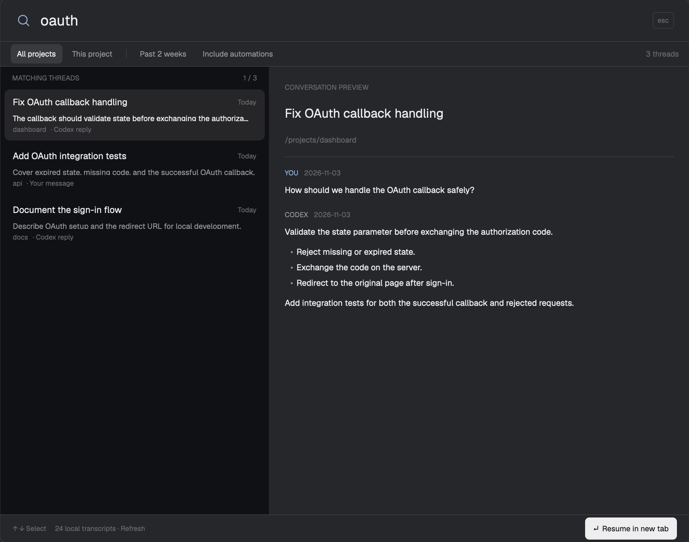

# Herdr Codex Search

Search, preview, and resume your local Codex conversations inside [Herdr](https://herdr.dev).



Find threads by title, project folder, thread ID, or words from your messages and Codex replies. Preview matching messages, filter to the current project or the past two weeks, and resume a conversation in a local Herdr tab. Automation threads are hidden unless you include them.

The preview uses fictional conversations. No conversation data is included in this repository.

## Requirements

- Herdr with its JavaScript mod API. Validated with Herdr 0.1.12 on macOS.
- `python3` on Herdr's PATH, with SQLite FTS5 support. Only the Python standard library is used; no pip or npm install.
- Codex CLI on Herdr's PATH, with local `state_*.sqlite` history and JSONL transcripts. Resume uses `codex resume <id> --no-daemon --cd <folder>`; validated against Codex CLI 0.166.0.
- macOS or Linux: the helper uses Unix file locking (`fcntl`) and the launcher uses `env`. Linux has not been tested; Windows is not supported by this version.

## Install

Ask your agent:

> Read ~/.config/herdr-app/AGENTS.md, then install the mod from https://github.com/vaibhav0806/herdr-codex-search. Read every file first, preserve existing mods and key bindings, and check the installed mod.

Or clone this repository, then run these commands from its root:

```sh
herdr_mod_home="${HERDR_APP_HOME:-$HOME/.config/herdr-app}"
mkdir -p "$herdr_mod_home/mods"
test ! -e "$herdr_mod_home/mods/thread-search" && cp -R mods/thread-search "$herdr_mod_home/mods/"
herdr-app check "$herdr_mod_home/mods/thread-search"
herdr-app do mod.open --name thread-search
```

If `thread-search` already exists, stop and compare it before installing; the copy command above skips an existing folder. A renamed installation also needs its self-references and asset paths updated.

No layout changes are required. Open the mod from Herdr's command palette, or optionally merge this binding into the `global` section of your existing `keys.json`:

```json
"cmd-shift-k": "mod.open:thread-search"
```

The root `keys.json` is only a snippet: **do not replace your existing key file**. Choose another unused binding if needed (for example `ctrl-shift-k` on Linux).

## Use

Type to search. Use Up/Down or click a result to select it; the right side previews matching messages. Enter or the Resume button focuses an already-running thread, otherwise opens it in an existing local project space or creates one. Escape closes the dialog.

Use Refresh to pick up conversations added or changed since opening. The first index builds in batches; results can appear before indexing finishes. “This project” uses the folder focused when the dialog opened and matches it exactly. “Past 2 weeks” filters by thread update time. “Include automations” adds automation threads alongside normal threads.

Threads whose transcript has disappeared remain searchable by metadata, but cannot be previewed or resumed. Resume also requires the original project folder and the Codex executable to exist.

## Local data and access

The mod runs a local Python helper. It reads Codex's latest numbered `state_*.sqlite` database in read-only mode and the transcript paths that database references. It uses `CODEX_HOME` from Herdr's environment, falling back to `~/.codex`. For a custom home, make sure Herdr inherits that variable before opening the mod.

It creates its own searchable index at `<Herdr app home>/data/thread-search/threads.sqlite`. That index contains conversation text, so keep it private. The mod does not modify the source database or transcripts and makes no network requests. Clicking Resume launches Codex, which uses your normal Codex configuration and services.

The index includes user and assistant messages from `cli` and `vscode` threads. It excludes subagent sources, tool/developer messages, recognized injected instructions, and assistant intermediate phases. It is a convenience search index, not a redacted export.

## Limitations

- This is Codex-specific, not a search across other agents or remote machines.
- Codex history uses internal formats that can change. Missing databases or incompatible schemas show an error.
- Search returns at most 60 threads. Body matching considers the best 2,000 message matches; previews show up to four messages, each capped at 6,000 characters.
- No background watcher: reopen or refresh to update the index.
- The optional sidebar launcher uses `props: {"launcher": true}` and displays the Mac shortcut; the dialog works without it.

## Checks

From this repository:

```sh
python3 -m unittest discover -s mods/thread-search -p 'test_*.py'
node --experimental-vm-modules --test mods/thread-search/test_view.mjs
herdr-app check "$PWD/mods/thread-search"
```

Node is only required for the UI behavior tests, not to run the mod. Tests use temporary synthetic history. The native preview was checked in Herdr with sample data; automated tests cover indexing, filtering, read-only sources, missing transcripts, and resume routing. A real conversation was not resumed as part of publication checks.

See [RECIPE.md](RECIPE.md) for the rebuild brief.
