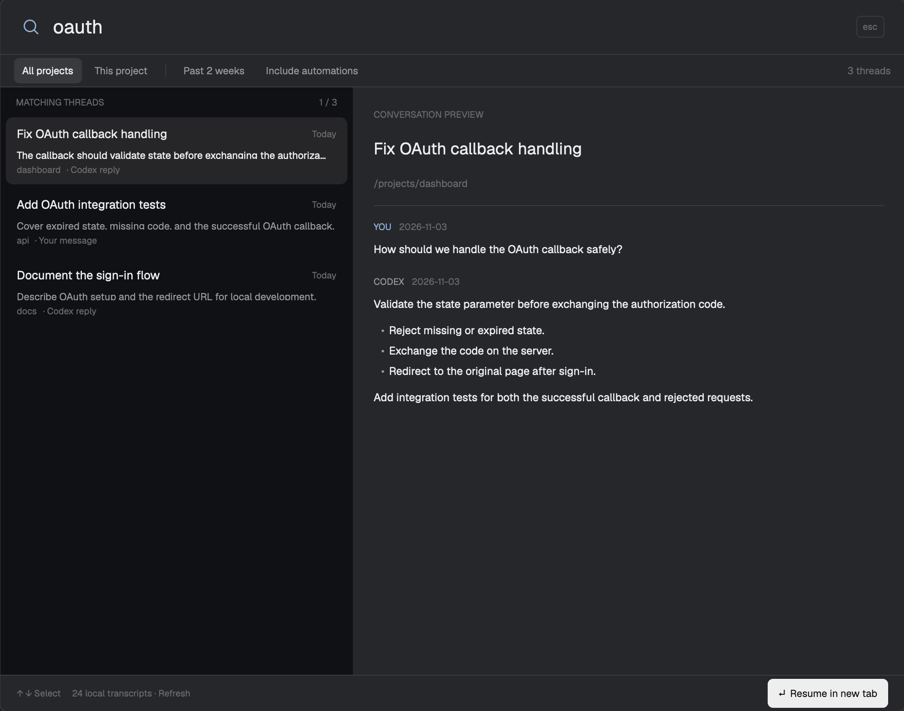

# Codex Thread Search

A searchable dialog for local Codex conversations in Herdr. A results list sits beside a conversation preview, with project and date filters above and a resume action below. The image contains sample conversations only.

## What you see

- A 900px-wide dialog, 60% of window height, following `theme()` colors: `popover` background, `chrome` result list, `selected` active result, `foreground`, `muted`, `dim`, and `accent` text.
- A 60px header with a 23px search icon, 21px input, and Escape hint. A 36px filter bar contains All projects, This project (when a folder was focused), Past 2 weeks, Include automations, and a result count.
- A 390px results column. Rows are 74px tall with a 4px bottom margin and show title, update date, snippet, project basename, matching role, and automation label. The selected row has a `selected` background.
- A flexible preview column with 22px padding, an 18px title, the project path, and scrollable markdown messages labeled YOU or CODEX. No-result, indexing, missing-transcript, and error states have explanatory text.
- A 40px footer shows keyboard hints, index count/Refresh, and Resume in new tab. Resume is dimmed while unavailable, loading, or validating.

## How it behaves

Input is debounced by 180ms. Search matches title, folder, ID, and indexed message text, ranking title matches first. Up/Down, scrolling, or clicking selects a result; Enter resumes it; Escape dismisses the dialog. Filters are toggles except All projects, which clears the project restriction. Recent means 14 days. Automations are excluded by default.

Opening starts a search and batched index refresh. Refresh repeats it, with progress and retry text. Late async responses cannot overwrite a newer search or selection. A missing transcript can still appear by metadata but cannot resume. Before launching, recheck the detail; repeated Enter must launch once. If the thread is already running, focus its agent. Otherwise reuse a matching local project space or create a local one, even when a remote space has the same folder.

This mod does not display working/blocked/done/idle agent statuses or animate them. Agent status never changes search ordering. Hover highlights controls and rows. The optional `launcher` prop renders a compact Search threads button instead of the dialog.

## Built from

There is no layout file. `mods/thread-search/mod.json` uses `place: "none"` and a dialog overlay `{width: 900, height: 0.6}`. `main.js` exports a GPUI `View`, using `InputState`, `Input`, flex builders, and `TextView.markdown`. `search.svg` is a self-contained magnifier asset. UI sizes use logical pixels.

Herdr APIs: `appHome`, `props`, `focused`, `spaces`, `terminals`, `theme`, `exec`, `run`, and `closeOverlay`. Commands: `mod.open`, `agent.focus`, `tab.new`, and `space.new`. Optional keys map `cmd-shift-k` to `mod.open:thread-search`. No shipped mod is required.

Every data request runs `python3 <appHome>/mods/thread-search/search.py --data <appHome>/data/thread-search <action>`. The Python helper has sync/search/detail actions and a SQLite FTS5 index. Read the latest numbered Codex state database read-only, select CLI/VS Code sources, parse their JSONL transcripts, and index user/assistant text. Use `CODEX_HOME` or `~/.codex`. Sync tracks inode/size/mtime, updates changed transcripts, removes deleted metadata, and uses a Unix file lock. Secure newly created index files with user-only permissions.

Resume uses `env CODEX_HOME=<home> <codex executable> resume <id> --no-daemon --cd <cwd>`. Resolve Codex with `shutil.which`. No network calls or external Python packages are needed. Herdr's `cx.spawn` and `cx.timer.after` handle asynchronous work; never retain an old context or use browser timers.

## Watch out

- Require macOS/Linux, Python with FTS5, and Codex on Herdr's PATH. Do not hardcode a Homebrew path. Windows needs a different lock and launcher implementation.
- Codex database/transcript schemas and CLI flags are version-dependent; show failures, do not fabricate empty success.
- Never bundle the user's databases, index, transcripts, settings, full key file, or a screenshot containing their work. Build previews with sample data.
- Treat results as local: a remote folder with the same path must not receive a local Codex resume.
- Project filtering is exact; automations are identified by titles beginning `Automation:`. Search caps results at 60 and body candidates at 2,000; previews cap messages at four and text at 6,000 characters each.
- Root instructions and tool/developer messages are excluded; recognized generated memory-citation markup is stripped for preview. This does not make the index safe to publish.
- Keep the input focused for selection/submit behavior. Preserve stale-response guards and the resume-in-progress guard.
- `herdr-app check` checks an initial render only. Exercise results and preview in the actual app too. Refresh is explicit; there is no background watcher.
- Renaming the mod requires updating the folder name, asset paths, helper path, self-opening command, and optional keys. Do not overwrite another mod or key binding.

## Done when

- The five Python tests pass with synthetic history, covering text search, instruction exclusion, missing transcripts, refresh/deletion, filters, and unchanged source bytes.
- The five Node tests pass, covering local resume routing, space reuse, missing-transcript revalidation, repeated Enter, and preview cleanup.
- `herdr-app check <mod folder>` passes, and the actual dialog displays selectable results and readable markdown without errors.
- A fresh install requires copying only the mod folder, with optional key merging; no layout replacement, npm install, or pip install.
- The package contains only source/tests, optional key snippet, documentation, and a preview of sample data.
